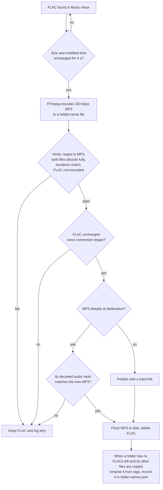

# Music Converter

Automatically convert FLAC songs and whole album folders to **320 kbps MP3**, verify the results, delete the converted FLACs, and name album folders:

```text
(Release Year) - Album Name - Artist
```


*A real run on macOS (2026-11-06) against generated test tones; see [Try it on test files](#try-it-on-test-files). Only the log's absolute inbox path was shortened.*

**Windows:** [Detailed fresh-PC setup](docs/WINDOWS.md)

**Mac:** [Detailed fresh-Mac setup](docs/MAC.md)

> **Original FLAC files are permanently deleted after successful verification.** MP3 is lossy. Keep a separate backup if you want to retain the lossless originals. Files in the inbox are treated as ready for conversion.

## Quick start

1. Install Python 3.10+ and FFmpeg with FFprobe. The guides above include installation commands and a manual alternative.
2. [Download the ZIP](https://github.com/cadeKukk/music-converter/archive/refs/heads/main.zip), extract it, and put the extracted folder somewhere permanent.
3. Double-click **Check Setup.cmd** on Windows or **Check Setup.command** on Mac.
4. Double-click **Start Converter.cmd** / **Start Converter.command**.
5. Drop finished album folders into **Music Inbox**, inside the downloaded application folder.
6. Find completed albums in **Music Inbox/Converted MP3**.

Example:

```text
Music Inbox/
  My Album/
    Disc 1/
      01 Song.flac
    cover.jpg
```

With matching music tags, the result is:

```text
Music Inbox/
  Converted MP3/
    (1977) - Rumours - Fleetwood Mac/
      Disc 1/
        01 Song.mp3
      cover.jpg
```

The original `01 Song.flac` is deleted after verification. The input folders and companion files remain. A loose FLAC directly inside Music Inbox produces its MP3 beside it, then is deleted.

## Try it on test files

To see what it does before trusting it with real music, generate a throwaway inbox of tagged sine-tone FLACs (a two-disc album with a cover, plus one loose track) and run the converter on that folder only:

```sh
python3 docs/make_demo_inbox.py demo-inbox
python3 converter.py --folder demo-inbox --once
find demo-inbox -type f | sort
```

This needs the same Python and FFmpeg as the converter and leaves your Music Inbox alone. Delete `demo-inbox` when you're done.

## Controls

Use `.cmd` files on Windows and `.command` files on macOS.

| Control | Behavior |
| --- | --- |
| Check Setup | Checks Python, FFmpeg, FFprobe, and the MP3 encoder. |
| Start Converter | Starts background conversion; you can close the launcher window. |
| Stop Converter | Stops conversion for this session. |
| Converter Status | Shows whether the converter is running and whether login startup is enabled. |
| Enable Login Startup | Starts it now and automatically at future logins. |
| Disable Login Startup | Removes login startup and stops it. |

Login startup is optional and starts disabled. The computer must be awake and you must be logged in. Stop keeps login startup enabled, so it will run at the next login; Disable Login Startup turns that off too.

## Conversion and deletion

Each FLAC goes through these steps in `converter.py`. Any failure keeps the original and is logged; the file is tried again after it changes or the converter restarts.



- Files are processed one at a time after size and modification time remain unchanged for four seconds. Finish slow transfers elsewhere, then move the complete folder into Music Inbox.
- MP3 output is 320 kbps, 44.1 kHz stereo. Multichannel audio is downmixed. Tags and the first embedded cover image are copied where supported.
- Both source and output are decoded completely. Audio durations must match within a small encoder tolerance, and a declared FLAC duration is checked for truncation.
- The output is flushed before the original is deleted. Files that fail verification, change during conversion, or are interrupted are retained.
- Existing MP3s are never replaced. An existing MP3 must have the same decoded audio hash as a verified fresh conversion before the source can be deleted. Otherwise both files are retained and the error is logged.
- Deletion is permanent, not a move to Trash or Recycle Bin.

### When a FLAC is kept


*A real run on macOS (2026-11-25, FFmpeg 8.0.1) against the same generated test tones. The log's absolute inbox path was shortened and four of FFmpeg's six decode-error lines are left out.*

Two things went wrong on purpose here:

- **A cut-off FLAC** (`02 E659.flac`) fails to decode, so no MP3 is published for it and the FLAC stays. The log line carries FFmpeg's own error text.
- **An MP3 already at the destination** (`loose track.mp3`) holds different audio from a fresh conversion, so neither file is touched and the log says `Existing MP3 does not match a fresh conversion; original kept`.

The other two tracks convert and are deleted as usual. Because one FLAC is still in the album folder, the output stays under its input name (`Converted MP3/Synthetic Tones (rip)`) and is renamed only once every track has converted. `--once` exits with status 1.

## Album names and collections

Naming uses embedded album, release date/year, and album-artist tags. Original-release date/year takes precedence where present; otherwise date/year is used. The most common year is selected. Album artist takes precedence over track artist; differing track artists become `Various Artists` when there is no common album artist.

Missing tags use `Unknown Year`, the input folder name as the album, and `Unknown Artist`. No online metadata lookup occurs. Unsupported filename characters are replaced. Name collisions get a numeric suffix, for example ` (2)`.

Nested disc folders are preserved. A collection with multiple tagged albums keeps its outer folder and renames individual album subfolders. Different albums mixed in the same flat folder are not split automatically. A failed track keeps its album pending; other tracks continue converting.

Visible artwork, booklets, and other files are copied unchanged. Playlist/CUE references are not rewritten. Hidden files, symbolic links, and Windows junctions are skipped. Empty directories are copied. Generated output is never watched as input.

## Files and troubleshooting

- `Music Inbox/.converter/converter.log`: conversion, deletion, naming, and error log.
- `Music Inbox/.converter/service.log`: startup errors.
- `Music Inbox/.converter/folder-names.json`: remembers destinations for later tracks; keep it with the inbox.
- Failed tracks are retried after their source changes or after restarting the converter.
- Existing companion files are not refreshed automatically.
- Use a local APFS/NTFS volume. Safe publication uses hard links; FAT/exFAT and some network/cloud-backed folders are unsupported. On publication failure the FLAC is kept.
- Use short application and input paths on Windows to avoid legacy path-length limits.

The source package is portable **after its dependencies are installed**; it is not a standalone EXE. Python and FFmpeg binaries are not bundled. Optional FFmpeg executables can be placed in `tools/` or `tools/bin/` instead of PATH.

## Command line and development

From the application folder (use `python3` on macOS, or `py -3` on Windows):

```sh
python manage.py check
python manage.py start
python manage.py status
python manage.py stop
python manage.py enable-login
python manage.py disable-login
python converter.py --folder "/path/to/inbox" --once
python -m unittest discover -s tests -v
```

`--once` skips the copy-settling delay and should only be used with completed files. It returns a nonzero status on file conversion errors. Without `--once`, the converter watches continuously; Ctrl+C stops a foreground run. A custom inbox uses its own state and lock; the double-click controls manage the standard Music Inbox.

GitHub Actions runs integration tests on Windows and macOS, including real FFmpeg conversions, deletion protection, naming, duplicate outputs, Unicode paths, background controls, and Windows login-shortcut creation/removal. Test audio is synthetic. Music files, state, logs, and binaries are ignored by Git.

This repository's application code is available under the [MIT license](LICENSE). FFmpeg is installed separately and has its own license.
